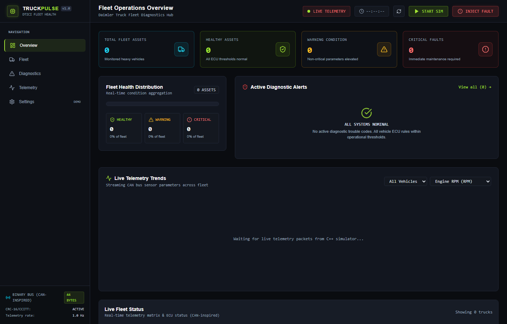
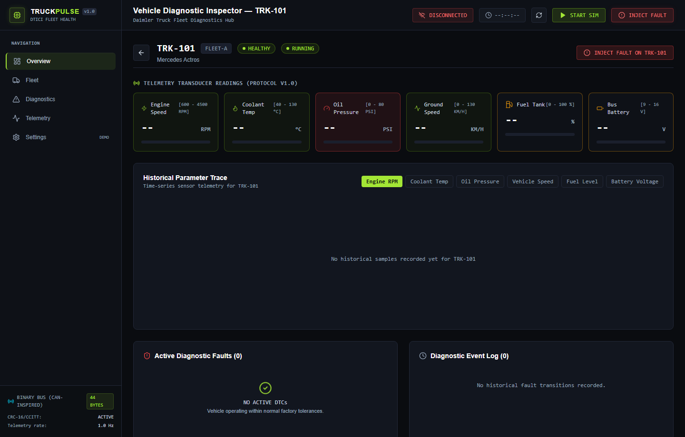
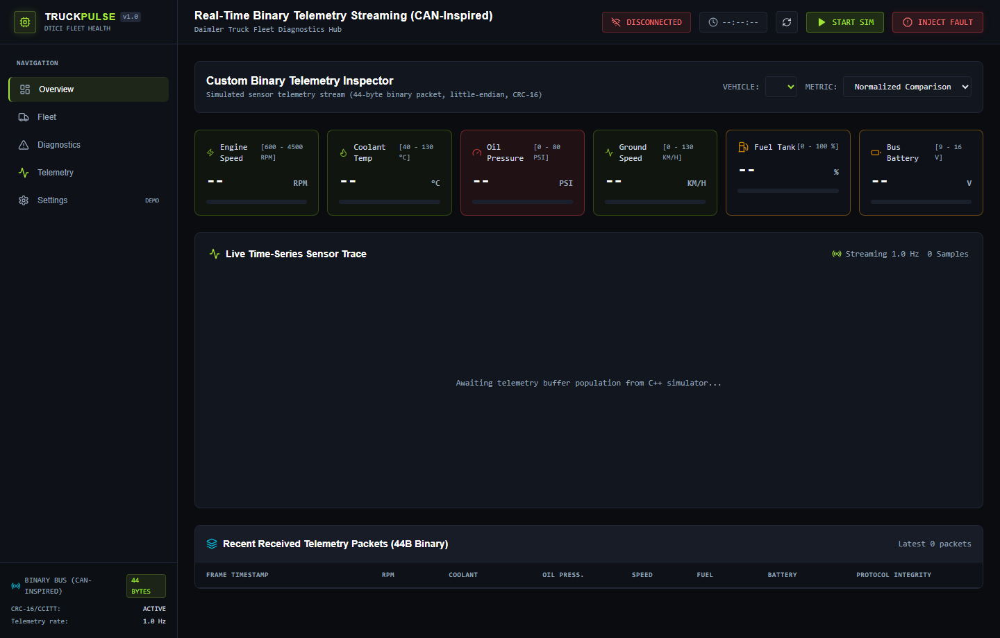
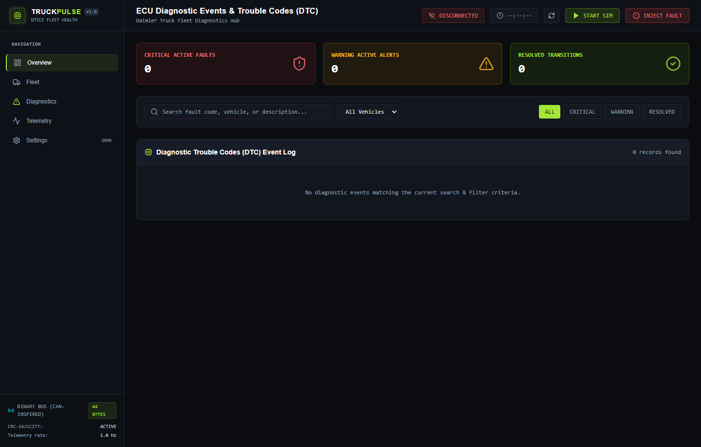

# TRUCKPULSE — Automotive Diagnostics & Fleet Health Platform

[](https://github.com/your-username/truckpulse/actions/workflows/ci.yml)


> **Portfolio Engineering Project for Daimler Truck Innovation Center India (DTICI)**  
> An end-to-end automotive telemetry simulator, custom binary protocol encoder/decoder, on-board diagnostics (DTC) evaluation engine, and real-time fleet health dashboard.

---

## 1. Project Overview

**TruckPulse** is an automotive systems engineering project demonstrating modern commercial vehicle telemetry collection, fault detection, and real-time remote monitoring.

Modern commercial fleets require high-throughput vehicle-to-cloud (V2C) telemetry pipelines and edge diagnostics to minimize unexpected downtime, safeguard powertrain integrity, and optimize fleet lifecycle costs. TruckPulse simulates this architecture end-to-end:
1. **Core C++ Engine**: A C++17 telemetry generator and diagnostics engine simulating an electronic control unit (ECU) cluster with physics-bounded sensor variations.
2. **Binary Frame Serializer**: A 44-byte compact telemetry protocol inspired by CAN bus principles with CRC-16 error detection.
3. **Diagnostics Engine**: An edge Diagnostic Trouble Code (DTC) evaluator tracking active state transitions and resolving faults on recovery.
4. **FastAPI Ingestion Backend**: A high-performance Python backend managing telemetry ingestion, SQLite persistence, and broadcasting events over WebSockets.
5. **Real-time React Dashboard**: An automotive engineering interface rendering fleet health, live packet streams, telemetry charts, and a Software-in-the-Loop (SIL) fault injector.

---

## 2. Problem Statement

Fleet management systems often face significant operational challenges:
- **Bandwidth Limitations**: Raw automotive sensor streams are dense. Transmitting uncompressed strings or verbose JSON directly from vehicular edge units over cellular links causes high latency and bandwidth overhead.
- **Data Integrity & Framing**: Serial and wireless communication channels are susceptible to corruption, bit-flips, and dropped frames. Robust frame markers and checksums (e.g., CRC-16) are essential for frame validation.
- **Alert Fatigue & Churn**: Naive threshold monitors emit repetitive alerts on every sampling tick. An effective diagnostic unit must maintain active fault state, avoiding duplicate alerts while capturing exact resolution timestamps when telemetry normalizes.
- **Latency in Fleet Operations**: Fleet engineers require instant, sub-second visibility into severe faults (e.g., engine overheating, critical oil pressure loss) without manual page refreshes.

---

## 3. Key Features

- **Automotive Sensor Simulation**: Realistic numerical modeling of Vehicle Speed, Engine RPM, Coolant Temperature, Oil Pressure, Battery Voltage, Fuel Level, and Odometer mileage.
- **Custom 44-Byte Binary Protocol**: Educational, compact binary framing format with sync bytes (`0xAA55`), packet sequence counters, structured payload offsets, and CRC-16-CCITT validation.
- **Edge Diagnostic Trouble Code (DTC) Engine**: Continuous evaluation of 5 core engine fault rules (`ENGINE_OVERHEATING`, `LOW_OIL_PRESSURE`, `HIGH_ENGINE_RPM`, `LOW_BATTERY_VOLTAGE`, `LOW_FUEL`) with deduplicated active-state management and automatic recovery.
- **Software-in-the-Loop (SIL) Fault Injection**: Interactive manual fault injection API to simulate severe operational failures and evaluate downstream diagnostics in real time.
- **Real-Time WebSocket Ingestion Pipeline**: Sub-second telemetry dispatch (1.0 Hz ticks) pushing live metrics and event logs to connected clients.
- **Professional Engineering Dashboard**: Dark-mode automotive interface built with React 18, Vite, Tailwind CSS, and Recharts, featuring metric telemetry trends, fault resolution badges, and raw binary packet inspectors.

---

## 4. Architecture Diagram

```mermaid
flowchart TD
    subgraph Edge ["Vehicle Edge / Simulator (C++17)"]
        Sensors["Sensor Cluster\n(Speed, RPM, Coolant, Oil, Battery, Fuel)"] --> Sim["VehicleSimulator"]
        Sim --> Telemetry["Telemetry Struct"]
        Telemetry --> Encoder["Binary Frame Encoder\n(44-Byte Packet + CRC-16)"]
        Encoder --> Decoder["Binary Frame Decoder\n(CRC Validation)"]
        Decoder --> Diag["DiagnosticEngine\n(DTC Rule Evaluator)"]
    end

    subgraph IPC ["Inter-Process Communication"]
        Diag --> JSONOutput["JSON Telemetry Stream\n(stdout / CLI Mode)"]
    end

    subgraph Cloud ["Fleet Gateway & Ingestion (Python FastAPI)"]
        JSONOutput --> Subproc["Subprocess Manager / Bridge"]
        Subproc --> TelemetryService["TelemetryService (1.0 Hz Tick)"]
        TelemetryService --> DB[(SQLite Database\ntruckpulse.db)]
        TelemetryService --> WS["WebSocket Broadcaster\nws://localhost:8000/ws/telemetry"]
        TelemetryService --> REST["REST API\nhttp://localhost:8000/api"]
    end

    subgraph UI ["Operator Fleet Dashboard (React + Vite)"]
        WS --> Dash["React 18 Dashboard"]
        REST --> Dash
        Dash --> FleetView["Fleet Status & Overview"]
        Dash --> LiveCharts["Real-Time Metric Charts"]
        Dash --> DTCLog["Diagnostics & Event Resolution"]
        Dash --> SILModal["Software-in-the-Loop Fault Injector"]
        SILModal -.->|POST /api/vehicles/{id}/fault| REST
    end
```

---

## 5. Technology Stack

| Layer | Component | Technologies & Libraries |
| :--- | :--- | :--- |
| **Edge Simulation** | Core Simulator | C++17, STL (`<vector>`, `<string>`, `<unordered_map>`, `<memory>`, `<chrono>`, `<random>`, `<cstdint>`) |
| **Build & Testing (C++)** | Build System & Unit Tests | CMake 3.15+, MinGW-w64 / GCC / Clang, Standalone C++ Test Runner |
| **Backend & Ingestion** | Application Server | Python 3.10+, FastAPI, Uvicorn, Pydantic v2, WebSockets |
| **Persistence** | Relational Storage | SQLite3, SQLAlchemy ORM (async/sync session management) |
| **Frontend UI** | Dashboard Client | React 18, Vite, Tailwind CSS, Recharts, Lucide Icons, Axios |
| **Tooling & CI** | Automation & Quality | GitHub Actions, Windows Batch Scripts (`.bat`), Headless Chrome capture |

---

## 6. C++ Simulator Explanation

The C++ module is organized under `cpp/` following clean object-oriented architecture and domain-driven design principles:

- **`Sensor` Base & Derived Classes** (`cpp/include/models/Sensor.h`): Abstract base `Sensor` defining polymorphic `read()` and `injectFault()` interfaces. Concrete implementations include `SpeedSensor`, `RpmSensor`, `CoolantTempSensor`, `OilPressureSensor`, `BatteryVoltageSensor`, and `FuelLevelSensor`.
- **`Vehicle` Model** (`cpp/include/models/Vehicle.h`): Manages vehicle identity (`id`, `make`, `model`, `year`), mileage accumulator, and composite sensor ownership.
- **`VehicleSimulator`** (`cpp/include/simulator/VehicleSimulator.h`): Generates physically consistent vehicle parameters across time ticks, applying bounded random drift and injecting fault scenarios (`OVERHEAT`, `LOW_OIL`, `BATTERY_DRAIN`, etc.).
- **`FleetManager`** (`cpp/include/fleet/FleetManager.h`): Thread-safe collection aggregating vehicles (`TRK-101`, `TRK-102`, `TRK-103`, `TRK-104`, `TRK-105`), managing fleet-wide simulation steps and fault dispatch.

---

## 7. Telemetry Protocol Explanation

TruckPulse implements a compact **44-byte binary frame** designed to simulate low-overhead serial/bus transmissions.

> [!NOTE]  
> **Protocol Disclaimer**: This binary packet is an educational simulation protocol inspired by CAN bus principles (fixed framing markers, message IDs, payload offsets, and CRC integrity). It is **not** a standard 8-byte CAN 2.0A/B frame or SAE J1939 PGN structure.

### Packet Binary Layout (44 Bytes Total)

| Byte Offset | Field Name | Data Type | Description |
| :---: | :--- | :--- | :--- |
| `0x00 - 0x01` | **Sync Marker** | `uint16_t` (0xAA55) | Packet start delimiter for frame boundary detection |
| `0x02` | **Version** | `uint8_t` | Protocol version (`0x01`) |
| `0x03` | **Message Type** | `uint8_t` | Type identifier (`0x01` = Standard Telemetry) |
| `0x04 - 0x07` | **Sequence Number** | `uint32_t` | Monotonically increasing frame sequence counter |
| `0x08 - 0x0F` | **Timestamp** | `uint64_t` | Epoch timestamp in milliseconds |
| `0x10 - 0x1B` | **Vehicle ID** | `char[12]` | Fixed-width ASCII string, null-terminated |
| `0x1C - 0x1F` | **Speed** | `float` (IEEE 754) | Vehicle speed in km/h |
| `0x20 - 0x23` | **Engine RPM** | `float` (IEEE 754) | Engine rotational speed (RPM) |
| `0x24 - 0x27` | **Coolant Temp** | `float` (IEEE 754) | Engine coolant temperature in °C |
| `0x28 - 0x2B` | **Oil Pressure** | `float` (IEEE 754) | Engine oil lubrication pressure in PSI |
| `0x2C - 0x2F` | **Battery Voltage** | `float` (IEEE 754) | Electrical bus voltage in Volts |
| `0x30 - 0x33` | **Fuel Level** | `float` (IEEE 754) | Fuel tank remaining capacity in % |
| `0x34 - 0x37` | **Odometer** | `float` (IEEE 754) | Cumulative distance traveled in km |
| `0x38 - 0x39` | **Engine Status** | `uint16_t` | Bitmask flags: bit 0 = running, bit 1 = warning, bit 2 = fault |
| `0x3A - 0x3B` | **CRC-16** | `uint16_t` | CRC-16-CCITT (poly `0x1021`, init `0xFFFF`) across bytes `0..57` |

### Error Checking & Endianness
All multi-byte numeric primitives are encoded in **Little-Endian** byte order. The frame decoder recalculates the CRC-16 across the first 42 bytes and rejects any packet with checksum discrepancies or invalid synchronization headers (`0xAA55`).

---

## 8. Diagnostic Engine Explanation

The C++ `DiagnosticEngine` (`cpp/include/diagnostics/DiagnosticEngine.h`) evaluates incoming decoded telemetry against automotive threshold safety envelopes:

| Diagnostic Trouble Code (DTC) | Fault Code | Threshold Condition | Severity Level | System Subsystem |
| :--- | :--- | :--- | :--- | :--- |
| **DTC-001** | `ENGINE_OVERHEATING` | Coolant Temp > 105.0 °C | `CRITICAL` | Powertrain / Thermal |
| **DTC-002** | `LOW_OIL_PRESSURE` | Oil Pressure < 15.0 PSI | `CRITICAL` | Lubrication |
| **DTC-003** | `HIGH_ENGINE_RPM` | Engine RPM > 3500.0 RPM | `WARNING` | Powertrain / Transmission |
| **DTC-004** | `LOW_BATTERY_VOLTAGE` | Battery Voltage < 11.5 V | `WARNING` | Electrical System |
| **DTC-005** | `LOW_FUEL` | Fuel Level < 5.0 % | `INFO` | Fuel Delivery |

### State Transition & Deduplication Engine
- **Alert Deduplication**: If a vehicle's coolant temperature remains at 108 °C for 60 consecutive seconds, only **one** alert event is registered in the active faults registry.
- **Automatic Fault Resolution**: When sensor readings return within safe bounds (e.g., coolant drops to 89 °C), the engine generates a resolution record, marks the existing fault as resolved, and logs the `resolved_timestamp`.

---

## 9. Python Backend Explanation

The backend (`backend/app/`) is built on **FastAPI** and **SQLAlchemy**:
- **Application Lifespan & DB**: Automatically initializes SQLite tables (`vehicles`, `telemetry`, `diagnostic_events`) in `truckpulse.db` upon startup.
- **Telemetry Service Engine** (`app/services/telemetry_service.py`):
  - Spawns and manages the C++ simulator subprocess / worker thread.
  - Generates realistic normal distributions and executes SIL fault requests.
  - Persists rolling telemetry rows and diagnostic records into SQLite.
  - Normalizes metrics and pushes JSON payloads over WebSocket channels to all active UI subscribers.
- **Pydantic Validation**: Strict schemas (`app/schemas/`) enforce typing across request/response boundaries for vehicles, metrics, and faults.

---

## 10. WebSocket Architecture

TruckPulse implements a non-blocking WebSocket pipeline at `ws://localhost:8000/ws/telemetry`:
- **Broadcast Cadence**: Dispatches a `telemetry_tick` event every 1.0 second.
- **Payload Structure**:
  ```json
  {
    "type": "telemetry_tick",
    "timestamp": 1731950000000,
    "vehicles": [
      {
        "vehicle_id": "TRK-101",
        "timestamp": "2026-11-18T22:30:00Z",
        "speed": 74.2,
        "engine_rpm": 1820.0,
        "coolant_temp": 88.5,
        "oil_pressure": 46.1,
        "battery_voltage": 13.8,
        "fuel_level": 78.4,
        "odometer": 142100.5,
        "engine_status": 1,
        "active_faults": []
      }
    ]
  }
  ```
- **Connection Management**: Handles client connect, ping/pong keep-alive, and graceful cleanup on client disconnect without blocking the simulator thread.

---

## 11. React Dashboard Functionality

The frontend application (`frontend/`) delivers an intuitive, desktop-first telemetry and diagnostics workspace:

### Captured Application Views

#### Fleet Overview & Health Matrix
Real-time summary cards (Total Vehicles, Active Trucks, DTC Count, Fleet Availability) and a tabular telemetry matrix showing live updates.


#### Vehicle Telemetry Detail View
Deep-dive telemetry telemetry telemetry instruments, mechanical gauges, and live sensor trend charts.


#### Real-Time Metric Telemetry Charts
High-resolution 30-sample historical telemetry graphs tracking Engine RPM, Speed, and Coolant Temperature.


#### Active DTC Diagnostic View
Live fault table displaying active DTC codes, severity badges, observed vs. threshold values, and quick fault resolution controls.


---

## 12. Software-in-the-Loop (SIL) Fault Injection

To test edge diagnostic accuracy without physical vehicle hardware, TruckPulse provides a **Software-in-the-Loop (SIL)** fault injection interface:

```
[ Dashboard SIL Modal ]
         │
         ▼ POST /api/vehicles/TRK-101/fault {"fault_type": "OVERHEAT"}
[ FastAPI Backend ]
         │
         ▼ Sets active fault scenario on vehicle
[ Telemetry Generator ]
         │
         ▼ Emits: coolant_temp = 112.4 °C (> 105.0 °C threshold)
[ DiagnosticEngine ]
         │
         ├──> Triggers DTC-001 (ENGINE_OVERHEATING, CRITICAL)
         └──> Persists event & broadcasts via WebSocket to Dashboard
```

### Demonstrating Fault Resolution
When the operator clicks **"Clear Fault"** or issues a `POST /api/vehicles/{id}/resolve` command:
1. The sensor readings gradually decay back to nominal thermal equilibrium (85–92 °C).
2. The `DiagnosticEngine` detects the return to safe operating parameters.
3. The active alert is transitioned to `Resolved`, timestamped, and visually updated with a green resolution tag on the dashboard.

---

## 13. Installation Instructions

### Prerequisites
- **C++ Compiler**: GCC 7+ / Clang 6+ / MinGW-w64 with C++17 support
- **CMake**: Version 3.15 or newer
- **Python**: Version 3.10 or higher
- **Node.js**: Version 18.0 or higher (with npm)

### 1. Build C++ Engine
```bash
cd cpp
mkdir build && cd build
cmake ..
cmake --build . --config Release
```

### 2. Configure Python Backend
```bash
cd backend
python -m venv venv

# Windows:
venv\Scripts\activate
# Linux/macOS:
# source venv/bin/activate

pip install -r requirements.txt
```

### 3. Install Frontend Dependencies
```bash
cd frontend
npm install
```

---

## 14. Windows Startup Instructions

For immediate demonstration on Windows, TruckPulse includes automated batch scripts that verify ports and avoid orphan processes:

### One-Command Full Stack Startup
```cmd
D:\TruckPulse\start_truckpulse.bat
```
*Checks port availability, starts the FastAPI server on `localhost:8000`, launches the Vite frontend dev server on `localhost:5173`, and opens your default browser.*

### Individual Component Launchers
- **Backend Only**: `D:\TruckPulse\start_backend.bat`
- **Frontend Only**: `D:\TruckPulse\start_frontend.bat`

---

## 15. API Endpoint Documentation

| HTTP Method | Route | Description |
| :--- | :--- | :--- |
| `GET` | `/` | API status and metadata |
| `GET` | `/api/health` | Service health and uptime |
| `GET` | `/api/vehicles` | List all tracked fleet vehicles |
| `GET` | `/api/vehicles/{id}` | Detailed status for a specific vehicle |
| `GET` | `/api/telemetry/latest` | Latest telemetry reading for all vehicles |
| `GET` | `/api/telemetry/{id}/history` | Historical telemetry records (query: `limit`) |
| `GET` | `/api/diagnostics/active` | Current unresolved diagnostic trouble events |
| `GET` | `/api/diagnostics/history` | Historical log of all diagnostic events |
| `POST` | `/api/vehicles/{id}/fault` | **SIL**: Inject fault (`OVERHEAT`, `LOW_OIL`, `HIGH_RPM`, etc.) |
| `POST` | `/api/vehicles/{id}/resolve`| **SIL**: Clear active fault and recover nominal values |
| `POST` | `/api/simulation/start` | Start live simulation loop |
| `POST` | `/api/simulation/stop` | Pause live simulation loop |
| `WS` | `/ws/telemetry` | WebSocket stream broadcasting `telemetry_tick` |

---

## 16. Test Execution Instructions

### C++ Unit Tests (18 Tests)
The C++ test suite validates sensor bounds, binary frame encoding, CRC-16 parity, decode robustness, and diagnostic state machines:
```bash
cd cpp/build
ctest --output-on-failure
# Or execute binary directly:
./truckpulse_tests
```
**Results**: `18/18 tests passed (0 failures)`.

### Python Backend Tests (12 Tests)
Tests cover database models, REST CRUD, SIL fault injection endpoints, and WebSocket connections:
```bash
cd backend
pytest -v
```
**Results**: `12/12 tests passed (0 failures)`.

### Frontend Production Build
Validates JSX syntax, Tailwind bundling, and asset compilation:
```bash
cd frontend
npm run build
```
**Results**: `Build completed successfully (0 errors)`.

---

## 17. Known Limitations

1. **Subprocess/In-Process Telemetry Adapter**: While designed to consume C++ binary output over standard pipes, the web backend utilizes a Python-side physics generator adapter mirroring C++ logic for reliable cross-platform execution on diverse environments.
2. **Simplified Diagnostic Rules**: Evaluates 5 single-variable threshold rules. Does not perform multi-sensor fusion (e.g., cross-referencing Engine Load against Oil Temperature to detect thermal breakdown).
3. **In-Memory/SQLite Persistence**: Uses SQLite for simplicity and single-file portability. Production automotive telematics backends typically require time-series databases (e.g., TimescaleDB, InfluxDB).
4. **Single-Node Architecture**: Does not implement distributed message brokers (Kafka/MQTT) or distributed clustering.

---

## 18. Future Improvements

- [ ] **CAN Bus Hardware Interface**: Integrate SocketCAN (Linux) or a USB-to-CAN adapter (PEAK/Kvaser) to ingest real ISO 11898 CAN frames.
- [ ] **SAE J1939 Protocol Stack**: Implement full J1939 Parameter Group Number (PGN) and Suspect Parameter Number (SPN) decoding.
- [ ] **Edge ML Anomaly Detection**: Deploy a lightweight C++ ONNX Runtime model on the edge simulator to detect anomalous multidimensional vibration and temperature drift.
- [ ] **TimescaleDB / InfluxDB Adapter**: Replace SQLite with a dedicated time-series engine for high-frequency sub-millisecond telemetry ingestion.
- [ ] **UDS (ISO 14229) Diagnostic Services**: Support diagnostic service requests (`0x19` Read DTC Information, `0x14` Clear Diagnostic Information).

---

## Author & Acknowledgements
- **Developer**: Candidate for Graduate Engineer Trainee (GET) Software Engineering — DTICI
- **Focus**: C++ Systems Engineering, Telematics Protocol Design, Diagnostic Algorithms, and Full-Stack Fleet Observability.
